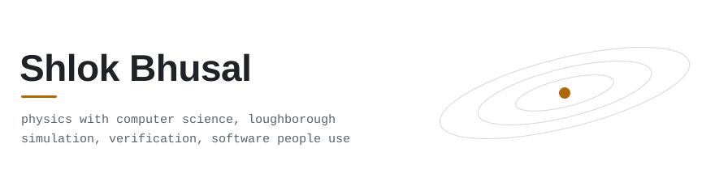

<picture>
  <source media="(prefers-color-scheme: dark)" srcset="assets/header-dark.svg">
  
</picture>

Final-year Physics with Computer Science student at Loughborough and a software engineering intern at Sumobaby. I build things from first principles and then check that they are right: simulators measured against the solver they would replace, and apps tested against the person who uses them every day.

### Physics and simulation

- **[Orrery](https://github.com/Protonicwave/orrery)** `C++20`  
  GPU-accelerated N-body gravitational simulator, developed and benchmarked on a single laptop. Published on PyPI as `orrery-nbody`.
- **[neural-network-physics](https://github.com/Protonicwave/neural-network-physics)** `Python`  
  Neural surrogates for N-body gravity and 2D fluid flow, with a harness that measures where a surrogate can be trusted. The honest headline: none beat the solver at matched accuracy.
- **[Ridgeline](https://github.com/Protonicwave/ridgeline)** `Python`  
  Local research assistant on a hardware-aware inference engine that places work across CPU, integrated GPU and NPU. Nothing leaves the machine.
- **[pinn-2d-heat-diffusion](https://github.com/Protonicwave/pinn-2d-heat-diffusion)** `PyTorch`  
  Physics-informed neural network for the 2D heat equation, trained with Adam and then L-BFGS.

### Software in use

- **[Taxi tracker](https://github.com/Protonicwave/taxi-tracker)** `TypeScript` · [live demo](https://protonicwave.github.io/tracker-showcase/)  
  Offline-first PWA built for my dad, a self-employed taxi driver. In daily use, one-handed, in a moving car.
- **[Second Shelf](https://github.com/Protonicwave/second-shelf-prototype)** `TypeScript` · [live demo](https://protonicwave.github.io/second-shelf-prototype/)  
  Decides when to reduce the price of fresh food. In a 30-day simulation it recovers £6,295 more than a fixed schedule and keeps 1,066 kg out of the bin.
- **[Sunflower Guard](https://github.com/Protonicwave/parrot-project)** `JavaScript` · [try it](https://protonicwave.github.io/parrot-project/)  
  Turns a phone into a bird scarer that keeps parakeets off a sunflower crop. No hardware, no account, works offline.
- **[Subtext](https://github.com/Protonicwave/subtext)** `Rust`  
  Desktop film player that treats subtitles as data: a transcript that follows playback, and search across every line in your library.

### Language models, verified

- **[Datasheet assistant](https://github.com/Protonicwave/datasheet-question-answering-assistant)** `Python`  
  Answers questions about sensor datasheets. Every answer cites its page and passage, and is shown only after code confirms the quote and every number in it.
- **Claude Code skills** `Python`  
  [engineer](https://github.com/Protonicwave/claude-skill-code), [writing](https://github.com/Protonicwave/claude-skill-writing), [latex](https://github.com/Protonicwave/claude-skill-latex) and [design](https://github.com/Protonicwave/claude-skill-design). Each ships with checker scripts and a test suite, so the rules are enforced rather than suggested.

### Toolbox

**Languages** TypeScript, Python, C++, C, Rust, PHP  
**Building** React, Vite, PyTorch, Firebase, PWAs  
**Checking** Vitest, pytest, mutation testing, GitHub Actions
